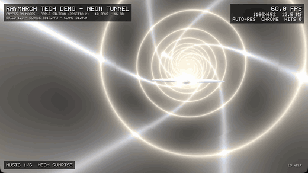
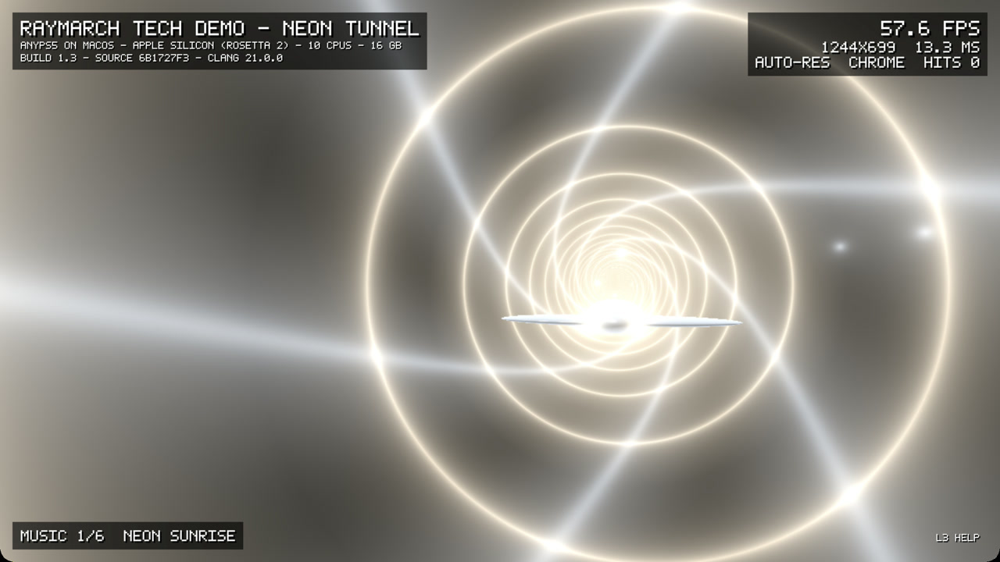
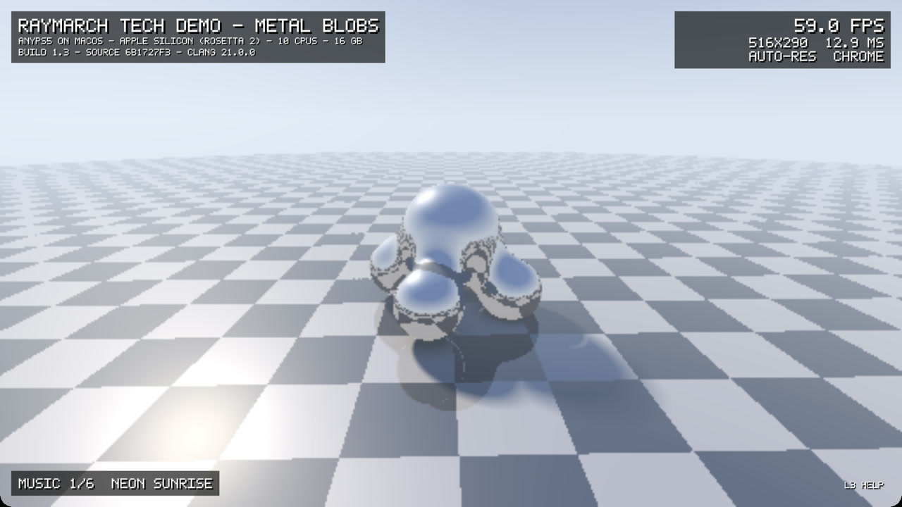

# Raymarch Tech Demo



A small native PS5 homebrew demo, written from scratch as a free test title
for [AnyPS5](https://github.com/boykopovar/AnyPS5) and its community macOS
port. It needs no commercial game data and exercises CPU threads, VideoOut,
AudioOut and DualSense input.

- Three scenes rendered by CPU worker threads. Metal Blobs has reflective
  shapes on a checkerboard floor. Neon Tunnel has a steerable spaceship,
  comets and lasers. Prism Observatory has a rotating crystal, three glowing
  rings and orbiting satellites against a star field.
- Dynamic internal resolution with optional 4x antialiasing, upscaled to
  1920 x 1080.
- Six original synthesized chiptune tracks in old-school cracktro style:
  Neon Sunrise, Cracktro 1987, Vector Balls, Disk Magazine, Hyperspace and
  SID Hearts.
- An overlay that reports where the demo runs (for example AnyPS5 on macOS
  under Rosetta 2, or real PS5 hardware), the build version and live stats.

## Download or build

- **v1.4 prebuilt ZIP** includes all three scenes. Download it from the
  [v1.4 release](https://github.com/Alexius0815/ps5-raymarch-techdemo/releases/tag/v1.4)
  and use the [AnyPS5 online relinker](https://boykopovar.github.io/AnyPS5/)
  to prepare the PS5 executable for your host. The release also provides
  SHA-256 checksums.
- **Build from source** using the instructions below. The release source is
  tagged `v1.4`.

The animated preview covers all three scenes. Metal Blobs and Neon Tunnel
were captured on an Apple M4 Mac running AnyPS5 under Rosetta 2 with MoltenVK.
The Prism Observatory sequence was rendered with the demo's CPU renderer.

| Neon Tunnel | Metal Blobs |
| --- | --- |
|  |  |

## Controls (DualSense)

| Input | Action |
| --- | --- |
| Right stick | Orbit the camera (blobs and observatory) / look around (tunnel) |
| Left stick | Zoom (blobs and observatory) / steer the ship (tunnel) |
| R2 | Fire lasers (tunnel) |
| Options | Motion steering on/off |
| Touchpad | Rumble on/off |
| Circle | Cycle through the three scenes (also every 30 s while idle) |
| Cross | Colour mood |
| Square | 4x antialiasing |
| Triangle | Dynamic resolution |
| L1 / R1 | Fixed internal resolution |
| D-pad left / right | Previous / next music track |
| L3 | Show or hide the help |

## Building

Requirements:

- clang with the `x86_64-sie-ps5` target (Xcode command-line tools work)
  and `ld.lld` from an LLVM release.
- The open [ps5-payload-sdk](https://github.com/ps5-payload-dev/sdk)
  (target headers and stub libraries).
- `ps5-native-tool` built from
  [ps5-native-app-boilerplate](https://github.com/BlackBearReloaded/ps5-native-app-boilerplate).

```bash
PS5_PAYLOAD_SDK=/path/to/ps5-payload-sdk \
PS5_NATIVE_TOOL=/path/to/ps5-native-tool \
LLD=/path/to/ld.lld \
./build.sh
```

This produces `build/eboot.elf`, a native PS5 executable.

## Running on macOS with AnyPS5

Build AnyPS5 for x86-64 macOS using the
[community macOS port instructions](https://github.com/boykopovar/AnyPS5/issues/1).
Pass the build directory to relink the executable for macOS:

```bash
ANYPS5_BUILD=/path/to/AnyPS5/build PS5_PAYLOAD_SDK=... PS5_NATIVE_TOOL=... ./build.sh
VULKAN_LOADER_DIR=/path/to/vulkan-loader \
MOLTENVK_ICD=/path/to/MoltenVK_icd.json \
./run_macos.sh --observatory
```

The command opens Prism Observatory. Running `./run_macos.sh` on its own
starts in Metal Blobs. Click the window before using the controller.
Output streams to the terminal and is saved in `run/play.log`.

Tested on an Apple M4 Mac (Rosetta 2, MoltenVK) with the AnyPS5 macOS
working stack. It has not been tested on a physical PS5.

## Smoke test

`eboot --smoke-test` renders 180 frames through all three scenes without
waiting for input, prints `[showcase-smoke] complete frames=180 scenes=3`
and exits with status 0. The v1.4 smoke test passed on an Apple M4 Mac
under Rosetta 2. It checks frame submission, vblank and normal exit.
Audio, controller input and image correctness require separate checks.

## License

GPL-3.0-or-later, see `LICENSE`. The startup code in `native/`, the
bitmap font and the presentation assets in `sce_sys/` come from
ps5-native-app-boilerplate; see `NOTICE.md` for attribution.

No SDK, compiler, emulator runtime, Sony module, firmware, key or commercial
game data is included in this repository.
