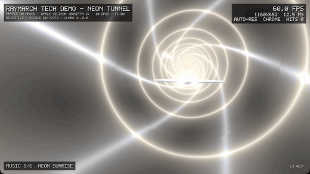
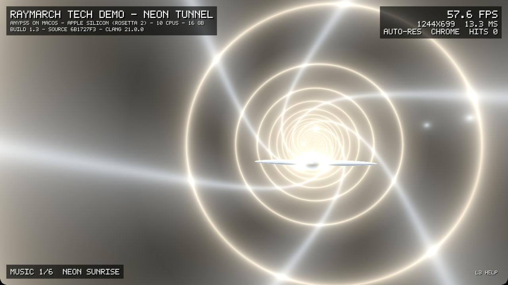
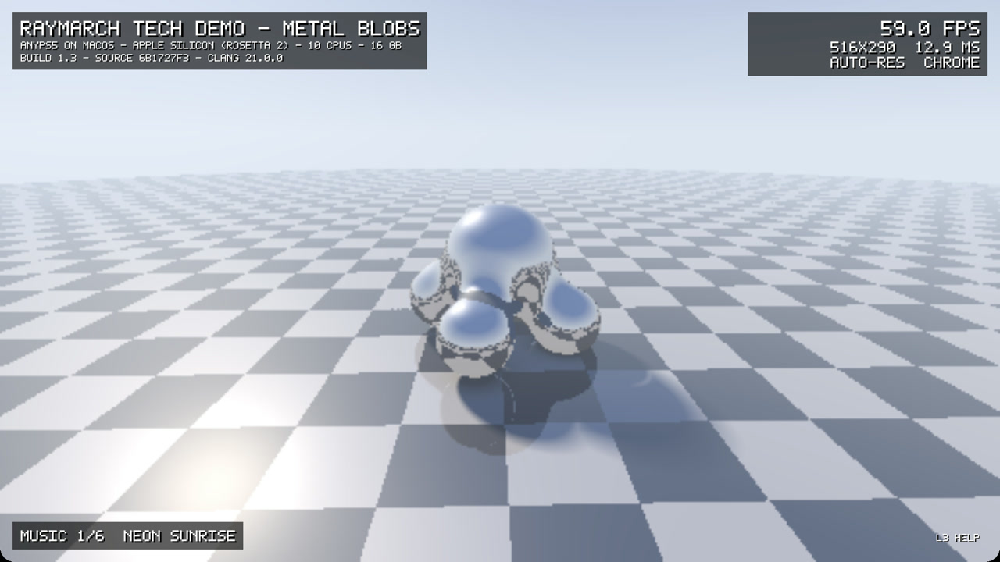

# Raymarch Tech Demo



A small native PS5 homebrew demo, written from scratch as a free test title
for [AnyPS5](https://github.com/boykopovar/AnyPS5) and its community macOS
port. It needs no commercial game data and exercises CPU threads, VideoOut,
AudioOut and DualSense input.

- Two scenes rendered on the CPU by worker threads: reflective metal blobs
  on a checkerboard floor, and a neon tunnel with a steerable spaceship,
  comets and lasers.
- Dynamic internal resolution with optional 4x antialiasing, upscaled to
  1920 x 1080.
- Six original synthesized chiptune tracks in old-school cracktro style:
  Neon Sunrise, Cracktro 1987, Vector Balls, Disk Magazine, Hyperspace and
  SID Hearts.
- An overlay that reports where the demo runs (for example AnyPS5 on macOS
  under Rosetta 2, or real PS5 hardware), the build version and live stats.

**Download:** the [latest release](https://github.com/Alexius0815/ps5-raymarch-techdemo/releases/latest) has a ZIP with the clean PS5 executable, ready for the
[AnyPS5 online relinker](https://boykopovar.github.io/AnyPS5/).

| Neon tunnel | Metal blobs |
| --- | --- |
|  |  |

Captured on an Apple M4 Mac with AnyPS5 (Rosetta 2, MoltenVK).

## Controls (DualSense)

| Input | Action |
| --- | --- |
| Right stick | Orbit the camera (blobs) |
| Left stick | Zoom (blobs) / steer the ship (tunnel) |
| R2 | Fire lasers (tunnel) |
| Options | Motion steering on/off |
| Touchpad | Rumble on/off |
| Circle | Switch scene (also every 30 s while idle) |
| Cross | Colour mood |
| Square | 4x antialiasing |
| Triangle | Dynamic resolution |
| L1 / R1 | Fixed internal resolution |
| D-pad left / right | Previous / next music track |
| L3 | Show or hide the help |

## Building

Requirements:

- clang with the `x86_64-sie-ps5` target (Xcode command-line tools work)
  and `ld.lld` from an LLVM release.
- The open [ps5-payload-sdk](https://github.com/ps5-payload-dev/sdk)
  (target headers and stub libraries).
- `ps5-native-tool` built from
  [ps5-native-app-boilerplate](https://github.com/BlackBearReloaded/ps5-native-app-boilerplate).

```bash
PS5_PAYLOAD_SDK=/path/to/ps5-payload-sdk \
PS5_NATIVE_TOOL=/path/to/ps5-native-tool \
LLD=/path/to/ld.lld \
./build.sh
```

This produces `build/eboot.elf`, a native PS5 executable.

## Running on macOS with AnyPS5

Build AnyPS5 for x86_64 macOS (see AnyPS5 issue #1 for the community macOS
port), then pass its build directory so the executable is also relinked
for macOS:

```bash
ANYPS5_BUILD=/path/to/AnyPS5/build PS5_PAYLOAD_SDK=... PS5_NATIVE_TOOL=... ./build.sh
VULKAN_LOADER_DIR=/path/to/vulkan-loader \
MOLTENVK_ICD=/path/to/MoltenVK_icd.json \
./run_macos.sh
```

Click the window before using the controller. Output goes to `run/play.log`.

Tested on an Apple M4 Mac (Rosetta 2, MoltenVK) with the AnyPS5 macOS
working stack. It has not been tested on a physical PS5.

## License

GPL-3.0-or-later, see `LICENSE`. The startup code in `native/`, the
bitmap font and the presentation assets in `sce_sys/` come from
ps5-native-app-boilerplate; see `NOTICE.md` for attribution.

No SDK, compiler, emulator runtime, Sony module, firmware, key or commercial
game data is included in this repository.
